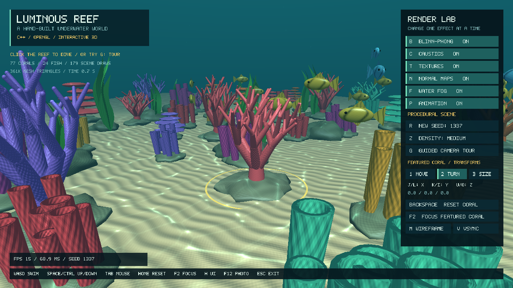

# Luminous Reef

A playable, single-scene underwater graphics prototype in **C++17, GLFW, GLAD and modern OpenGL**. The meshes, diffuse textures, normal maps and caustic texture are generated by the application. No game engine, model files, downloaded texture assets or external GUI library are needed.



## Start here: Visual Studio on Windows

Use **Visual Studio**, not a single-file C++ runner. Keep the whole extracted folder together.

1. In Visual Studio Installer, enable **Desktop development with C++**. Ensure the MSVC compiler, a Windows SDK, and **C++ CMake tools for Windows** are installed.
2. Extract the ZIP to a normal writable folder, for example `C:\Projects\LuminousReef`. Do not run it inside the ZIP.
3. In Visual Studio, choose **File > Open > Folder**, then select the folder containing `CMakeLists.txt`.
4. Choose the **Windows x64 Release** CMake preset. Allow the first configuration to finish. It downloads and builds the pinned GLFW 3.4 source release, which already contains a generated GLAD loader. Internet is required for this first configuration.
5. Select **LuminousReef.exe** as the startup target, then **Build > Build All** and **Debug > Start Without Debugging** (`Ctrl+F5`). Use `F5` when you specifically want the debugger.
6. Click the reef to capture the mouse. Use `WASD` to swim. Press `Tab` to release the mouse and click the Render Lab buttons. Try **F2** to inspect the featured coral closely.

GLFW is built as a static library. Do not add a separately downloaded `glfw3.dll`, an existing `glad.c`, or GLUT to this project.

### Alternative: a traditional VS 2022 solution

Open **x64 Native Tools Command Prompt for VS 2022**, change into this folder, and run:

```bat
build_and_run_vs2022.bat
```

The script generates `build-vs\LuminousReef.sln`, builds Release, runs the CPU tests, then launches the application. You can subsequently open that `.sln` in Visual Studio. The batch file is specifically for VS 2022; the Open Folder method is the preferable route for another recent Visual Studio version.

Equivalent commands:

```bat
cmake -S . -B build-vs -G "Visual Studio 17 2022" -A x64
cmake --build build-vs --config Release --parallel
ctest --test-dir build-vs -C Release --output-on-failure
build-vs\Release\LuminousReef.exe
```

### Requirements and dependencies

- C++17 compiler and CMake **3.21 or newer**.
- Graphics driver supporting **OpenGL 3.3 Core or newer**. The app first requests **4.1 Core**, matching the proposal's 4.x direction; it falls back to 3.3 Core when necessary. Every shader uses GLSL 330 and every rendering feature fits the 3.3 baseline.
- First configuration: Internet access to the official GLFW source archive. Subsequent builds use CMake's cached copy.
- No Python, GLM, stb_image, GLUT, GLEW, Assimp, ImGui, CUDA or game engine is required.

The GLAD loader is the already-generated header at `deps/glad/gl.h` in GLFW 3.4. Its declaration surface includes older functions, but this application requests a **Core** context and uses no immediate-mode/fixed-function rendering. `src/glad_impl.c` supplies the loader implementation exactly once.

For offline configuration, extract the complete official **GLFW 3.4 source** archive into `external/glfw`, so `external/glfw/CMakeLists.txt` and `external/glfw/deps/glad/gl.h` exist. A Windows binary-only GLFW ZIP is not sufficient for this route. The CMake file detects the local source directory and skips the download. `external/` is ignored by Git by default; change that deliberately when distributing a vendored, fully offline source repository, and retain its upstream license notices.

## What the demo implements

The reef includes three procedural coral mesh types: branching coral, open tube clusters and layered plate coral. A seeded minimum-distance sampler distributes the coral field. Scale, rotation and tint vary per instance. The sampler reserves a dive lane and a small area for one deliberately fixed, inspectable coral.

The seabed is a triangulated height surface, rocks are deformed parametric spheres, and kelp consists of curved ribbons with analytic vertex-shader sway. Fish use an explicit parent-child transform hierarchy: a swimming root contains a body, fins, eyes and a tail pivot. Four species have distinct procedural scale patterns, colors and field-guide records. Click a fish with the cursor released to inspect its species, length, weight and trait; the field log tracks which species you have found. Their elliptical routes and tail oscillation are scripted, not schooling AI.

The lighting combines ambient, diffuse and Blinn-Phong specular terms. A generated caustic texture is projected in world-space XZ and animated with two scrolling layers. Generated diffuse and tangent-space normal textures add surface detail. Distance fog, a water-colored background and additive bubble sprites complete the underwater appearance.

Coral, rock and kelp meshes use instanced drawing. The UI exposes actual accepted coral count, fish count, scene draw submissions, submitted mesh triangle count, FPS and frame interval. One featured coral has editable translation, Euler rotation and non-uniform scale.

## Controls

| Key / input | Action |
|---|---|
| Left-click a fish with the cursor released | Scan it and open its field-guide record |
| Left-click open water | Capture mouse and enter manual camera mode |
| Tab | Capture/release the mouse; release it to use the menu and scan fish |
| Mouse | Look around while captured |
| W / A / S / D | Move forward / left / backward / right |
| Space / Left Ctrl | Swim up / down |
| Left Shift | Faster movement |
| Mouse wheel | Change field of view |
| Home | Restore overview camera |
| F2 | Focus the featured coral |
| G | Toggle guided camera orbit |
| R | Generate a layout with the next seed |
| Z | Cycle low / medium / high scene density |
| P | Pause/resume fish, kelp, light, caustics, bubbles and the guided tour |
| B | Toggle Blinn-Phong lighting |
| C | Toggle the caustics contribution |
| T | Toggle diffuse texturing |
| N | Toggle normal mapping |
| F | Toggle distance fog |
| M | Toggle mesh wireframe |
| V | Toggle vertical synchronization |
| H | Show/hide the UI and featured-coral marker |
| 1 / 2 / 3 | Edit featured coral translation / rotation / scale |
| J / L | Decrease / increase the selected X component |
| K / I | Decrease / increase the selected Y component |
| U / O | Decrease / increase the selected Z component |
| Backspace | Reset the featured coral transform |
| F12 | Save a BMP screenshot in `screenshots/` under the working directory |
| Esc | Exit |

Menu buttons provide the same effect toggles and principal scene controls. Normal mapping is inactive when texturing is off. Caustics are inactive when lighting is off. Pause freezes scene time, not manual camera movement or transform editing.

## Source map

```text
LuminousReef/
  CMakeLists.txt             Build and dependency configuration
  CMakePresets.json          Visual Studio x64 Debug/Release presets
  build_and_run_vs2022.bat   Traditional VS 2022 solution route
  src/
    main.cpp                Window, input, camera interaction, UI and render loop
    Math.hpp                Vectors and explicit column-major matrix math
    Procedural.hpp          Seeded random values, seabed height, minimum-distance sampler
    Graphics.hpp/.cpp       Shaders, buffers, instancing, textures, BMP capture
    Geometry.hpp/.cpp       Coral, seabed, rock, kelp and fish-part mesh construction
    Scene.hpp/.cpp          Scene assembly, fish hierarchy and rendering
    UI.hpp/.cpp             Clickable 2D triangle-based overlay
    glad_impl.c             One GLAD implementation translation unit
  shaders/
    reef.vert/.frag         MVP, lighting, texture mapping, caustics and fog
    background.vert/.frag   Underwater background
    bubbles.vert/.frag      Transparent circular point sprites
    ui.vert/.frag           2D overlay
  tests/
    math_tests.cpp          CPU-only math and placement tests
    MANUAL_ACCEPTANCE.md    Checks to perform on the actual presentation machine
  docs/
    DEMO_SCRIPT.md          A 4 minute 30 second live-demo outline
    COURSE_ALIGNMENT.md    Course topics, rubric and proposal differences
    EXPLAIN_THE_CODE.md     The formulas and implementation details to understand
    TEST_REPORT.md          What was actually tested, and what was not
    controls.png           Screenshot captured from the renderer
    preview.png            Screenshot captured during the guided tour
  THIRD_PARTY.md            Dependency and reference attribution
```

The project intentionally does not include the team's final report or a modified presentation. Use the supplied course report template for the eventual submission, and use measurements from the actual presentation computer in its results section.

## Tests, screenshots and repeatable captures

The CPU tests check scale-rotate-translate order, view/projection conventions, parent-child composition, repeatable seeds, reserved space and minimum coral-seed spacing.

```bat
ctest --test-dir build-vs -C Release --output-on-failure
```

To run a finite renderer smoke test and save its final frame:

```bat
build-vs\Release\LuminousReef.exe --frames 120 --fixed-dt 0.0166667 --capture reef.bmp --check-gl
```

`--check-gl` exits with an error if an OpenGL error is observed after rendering. It does not replace visual inspection or real input tests.

A reproducible tour frame sequence:

```bat
build-vs\Release\LuminousReef.exe --tour --no-ui --no-vsync --frames 288 --fixed-dt 0.041666667 --capture-dir captures --check-gl
```

This produces 288 BMP files, representing 12 seconds at 24 frames per second. The sequence consumes approximately 760 MiB at 1280 x 720. It is an offline fixed-timestep capture, **not a claim of real-time 24 FPS performance**. Optional FFmpeg can encode the frames; FFmpeg is not an application dependency:

```bat
ffmpeg -framerate 24 -i captures/frame_%%05d.bmp -c:v libx264 -crf 20 -pix_fmt yuv420p -movflags +faststart preview.mp4
```

The doubled `%%` is for a `.bat` file. At an interactive command prompt, use `frame_%05d.bmp` instead. `--help` lists all options, including seed, density, effect toggles and resolution.

## Performance and honest limitations

Use **Release**, begin at medium or low density, and measure on the actual target GPU. `V` disables vsync for a comparison; re-enable it for a stable live presentation. Do not benchmark while saving every frame to disk. FPS/frame interval is a whole-frame observation, not a GPU timer query.

At seed 1337, medium density submits 76 procedural corals plus the featured coral. With the UI marker visible, the scene submits 179 draw calls and 361,921 mesh triangles. The UI adds its own batched draw and is not included in those scene counters. Counts vary with seed and density.

This is a stylized graphics prototype. It does **not** implement cast shadows, physically accurate caustics/refraction, a simulated water surface, fish behavior AI, object collision, an asset importer, multiplayer, a day-night cycle, HDR bloom or a full scene editor. The camera is only constrained by the scene bounds and seabed height. Seed spacing is not a guarantee that the full bounds of differently scaled meshes never intersect. The background is a shader gradient, not a modeled water surface.

Read `docs/TEST_REPORT.md` before making testing or performance claims. In particular, the renderer was tested through a local Linux software-OpenGL adapter; the real GLFW/GLAD integration and Visual Studio/MSVC build still need to be checked on Windows.

## Troubleshooting

**CMake cannot download GLFW:** check connectivity to GitHub, or use the offline source-directory layout above. The project does not require Python or a package-manager installation.

**Wrong compiler / missing Windows SDK:** add Desktop development with C++ in Visual Studio Installer, then reopen the folder. Use the x64 preset.

**Cannot find `glad/gl.h`:** build the full CMake project. Its header comes from the fetched GLFW source tree. Adding only `main.cpp` to a different solution will not configure the dependencies.

**Duplicate GLAD symbols:** remove manually added GLAD implementation files. This project compiles only `src/glad_impl.c`.

**No OpenGL Core context:** update the vendor graphics driver and run locally rather than through an environment exposing only an old software OpenGL implementation. The program prints context-creation errors in its console.

**Shader folder missing:** keep the complete `shaders/` folder next to the executable. The CMake shader-copy target refreshes it when the project builds. Also rebuild after editing a shader.

**Movement or menu seems unresponsive:** click the scene to steer, or press Tab to release the mouse for buttons. Press Home to recover the overview and F2 to find the featured coral.

**Low FPS:** build Release, select low density with Z, reduce window size, leave wireframe off, and stop continuous screenshot capture. Report the real hardware and results rather than promising a fixed FPS.
